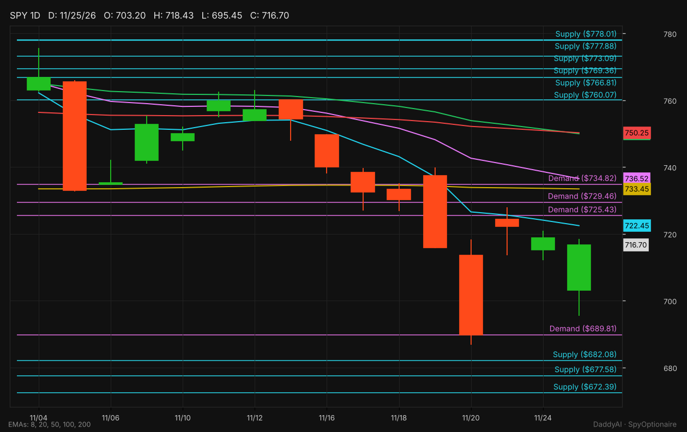
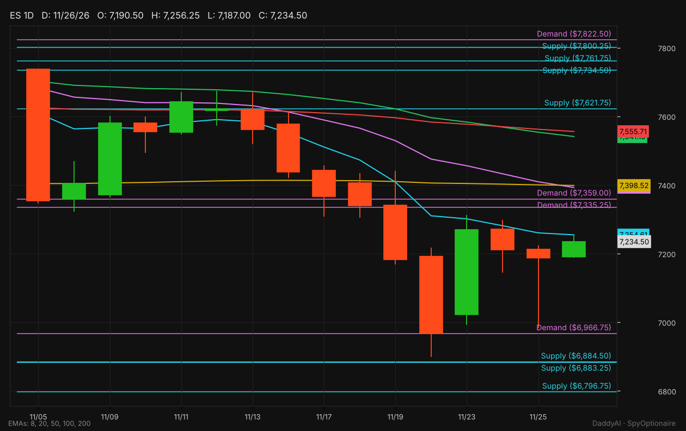
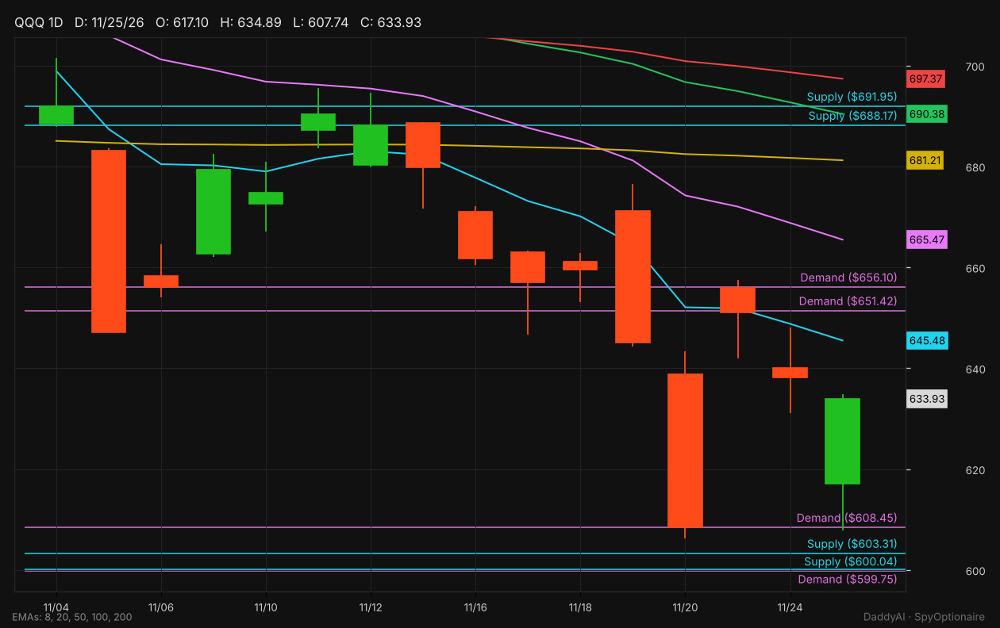
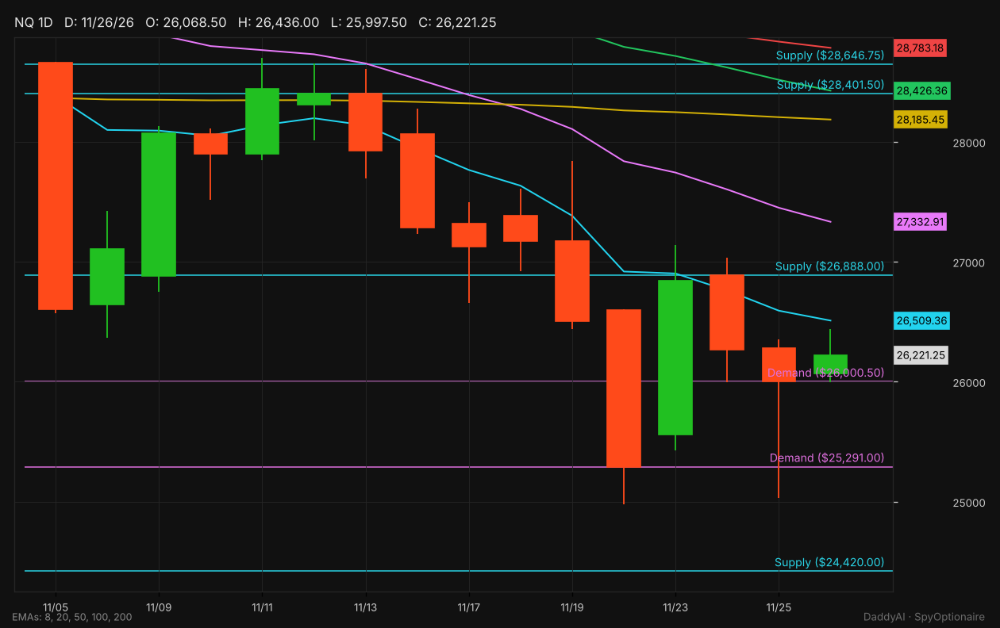
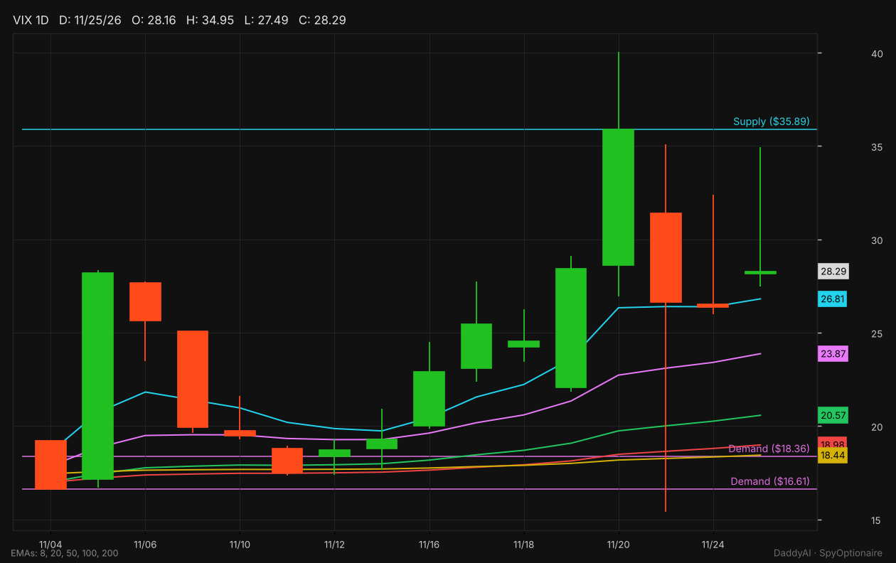
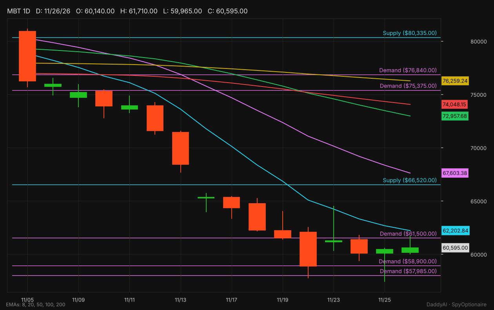

Happy Thanksgiving guys! Quick schedule note so nobody gets caught. The stock market is closed today, Thursday. ES/NQ futures closed at 1:00 PM ET today and reopen at 6:00 PM ET tonight for Friday's session.

Friday is a half day: the stock market opens at 9:30 AM and closes at 1:00 PM ET, and ES/NQ close at 1:15 PM ET (12:15 PM CT). After that everything is closed until futures reopen Sunday at 6:00 PM ET. Expect thin volume.

Wednesday was all about the flush and the recovery. SPY and QQQ gapped down, flushed right into last Friday's 11/20 demand, and then buyers stepped in hard and ripped them back to close near the highs of the day. That long lower wick tells me the bulls are defending the 11/20 lows for now.

Don't let one green candle fool you though... the bears are still in control on the daily. Delta is still showing sellers on the daily, and the 8ema is crossed under the 20ema on SPY, ES, QQQ and NQ, which is bearish. Until we CLOSE back over the 8ema the bigger trend is still lower.

### SPY/ ES DAILY

SPY put in a big green candle off the gap down. It opened at 703.20, flushed to 695.45 (about 6 points above the 689.81/ 6966.75 demand), and closed at 716.70. We closed just under the 8ema at 722.45/ 7254.61 and the 8 is still under the 20ema, so the daily trend is bearish. The good news for the bulls is that the supply/ demand indicator remains bullish for now on both SPY and ES.

Bulls need to close over 722.45/ 7254.61 (daily 8ema) minimally to gain some momentum to the upside. Realistically though, the first real bullish step is closing back over the 729.46-734.82/ 7335.25-7359.00 area (old demand/ support that is now resistance) along with the 20ema at 736.52/ 7392.57. From there a breakout to the bears' last stand at the 50/100ema (749.96-750.25/ 7541.10-7555.71) is in play. Until bulls retake that 100ema though, the market remains bearish longer term.

Bears need to CLOSE back under the 689.81/ 6966.75 demand, the 11/20 lows. IF bears CLOSE under it, I would look for the March supply at 682.08/ 6884.50 and then 677.58/ 6796.75.

**SPY DAILY LEVELS**

Supply- 722.45 (8ema) -> 725.43 -> 729.46 -> 734.82 -> 736.52 (20ema)

Demand- 689.81 -> 682.08 -> 677.58

**ES DAILY LEVELS**

Supply- 7254.61 (8ema) -> 7335.25 -> 7359.00 -> 7392.57 (20ema)

Demand- 6966.75 -> 6884.50 -> 6796.75

### QQQ/ NQ DAILY

QQQ did the same thing but with a bigger wick. It wicked UNDER the 608.45 demand at 607.74 and then reclaimed it all the way back to 633.93. Tech is still the weaker of the two, at -0.65% on the day vs -0.29% for SPY.

Here's where they differ. SPY, ES and QQQ all remain bullish on the supply/ demand indicator. However, on NQ the bears actually put in a new supply/ resistance at 26888, but today's bounce put in a new demand/ support at 26000.50. We're still under the 8ema at 645.48/ 26509.36 with the 8 under the 20ema at 665.47/ 27332.91. Daily bear momentum is also at an extreme right now.

Bulls need to close over 645.48/ 26509.36 (8ema) minimally to gain some momentum to the upside. Realistically though, the first real bullish step is closing back over the 651.42-656.10 old demand area (now resistance)/ the 26888 supply, along with the 20ema at 665.47/ 27332.91. From there a breakout to the bears' last stand at the 50/100ema (690.38-697.37/ 28426.36-28783.18) is in play. Until bulls retake that 100ema though, the market remains bearish longer term.

Bears need to CLOSE back under the 608.45/ 25291-26000.50 demand area. IF bears CLOSE under it, the next real level is the March supply at 603.31-600.04/ 24420.

**QQQ DAILY LEVELS**

Supply- 645.48 (8ema) -> 651.42 -> 656.10 -> 665.47 (20ema)

Demand- 608.45 -> 603.31 -> 600.04

**NQ DAILY LEVELS**

Supply- 26509.36 (8ema) -> 26888 -> 27332.91 (20ema)

Demand- 26000.50 -> 25291 -> 24420

### VIX

VIX spiked all the way to 34.95 at Wednesday's flush, right under its 11/20 supply at 35.89, and then got sold back down to close at 28.29 as SPY ripped off the lows. That's congruent with the bounce... fear got rejected at the same time buyers defended the 11/20 lows. VIX still closed up 7.3% on the day though, and it's above its 8ema at 26.81 with the 8 over the 20, so fear is still elevated even with the supply/ demand indicator bearish on VIX.

The bulls want VIX back under the 8ema at 26.81 and then the 20ema at 23.87. A VIX CLOSE over the 35.89 supply would be a red flag for SPY and QQQ. Watch for a disconnect too: if SPY pushes higher and VIX does NOT come down with it, I wouldn't trust that bounce.

**VIX DAILY LEVELS**

Supply- 35.89

Demand- 26.81 (8ema) -> 23.87 (20ema) -> 18.36

### BITCOIN

*Bitcoin levels are based on CME Bitcoin futures (MBT).*

Bitcoin is IMBALANCED right now: it closed and has held under its previous daily demand/ support at 61,500 (the 11/19 demand), and it's still the weakest chart of the bunch. It flushed to 57,385 on Wednesday, bounced to close at 60,435, and today's short session closed at 60,595. We're still well under the 8ema at 62,203 with the 8 under the 20ema at 67,603, so the daily trend is bearish, and daily bear momentum is at an extreme. The supply/ demand indicator is bullish for now.

Bulls need to CLOSE back over 61,500 to get back in balance, and over the 8ema at 62,203 minimally to gain some momentum to the upside. From there the next real level is the 66,520 supply along with the 20ema at 67,603. Until bulls retake the 100ema at 74,048 though, Bitcoin remains bearish longer term.

Bears need to CLOSE back under the 58,900 demand. IF they do, I would look for 57,985 and then the 53,695-53,770 area.

**BITCOIN (MBT) DAILY LEVELS**

Supply- 61,500 -> 62,203 (8ema) -> 66,520 -> 67,603 (20ema)

Demand- 58,900 -> 57,985 -> 53,770

