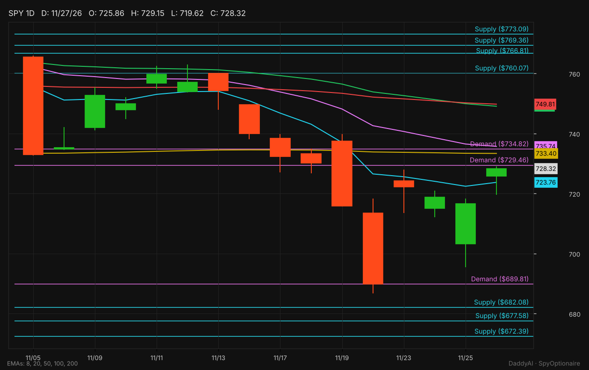
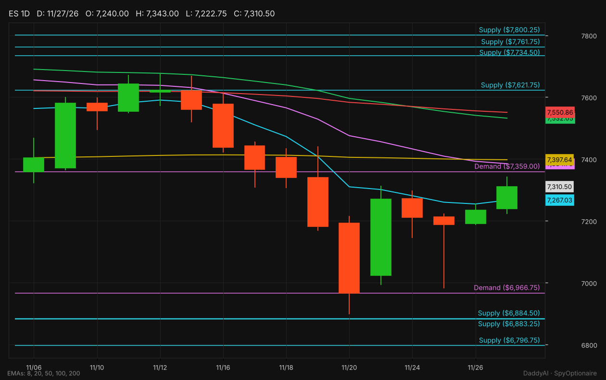
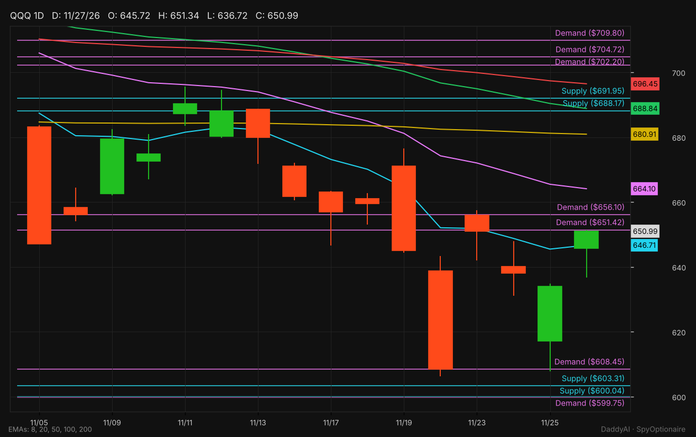
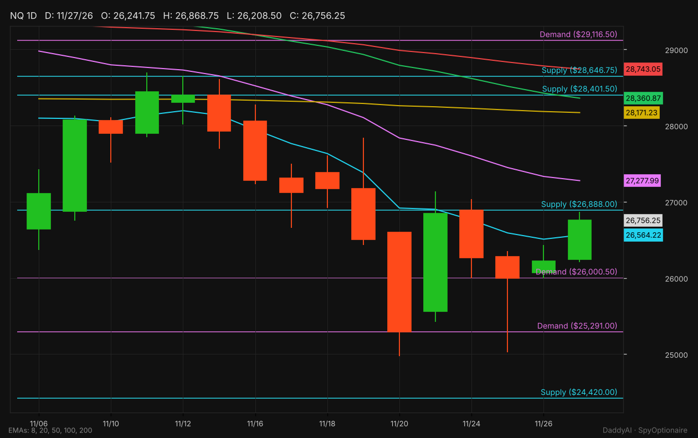
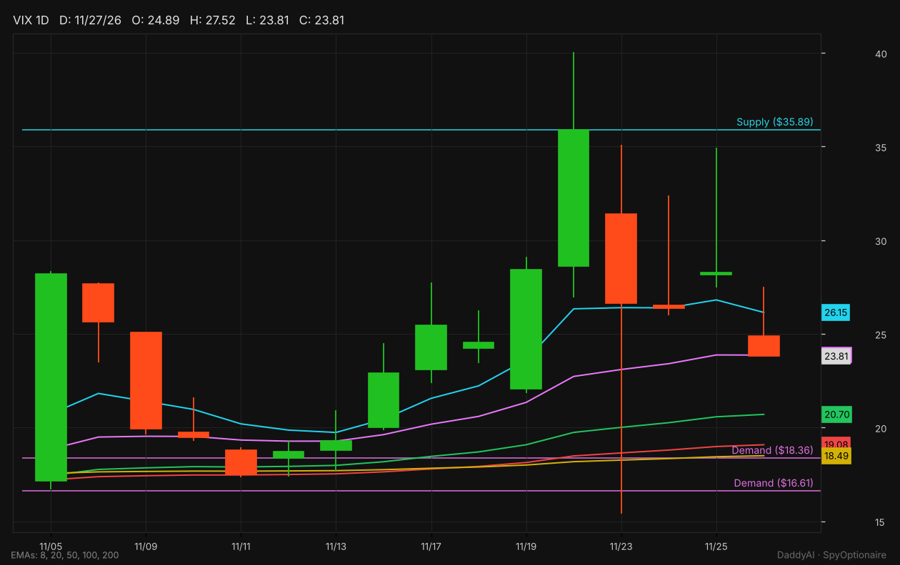

The Thanksgiving gap held guys. SPY, ES, QQQ and NQ all closed back over the daily 8ema for the first time in over a week, with tech leading. But every one of them stopped right under the same kind of wall: old support that flipped to resistance. That wall is the story into next week.

The bears still own the bigger trend. Delta still shows sellers on the daily, but they're fading, and the 8ema is still under the 20ema on all four. Daily momentum is turning up though, and the supply/ demand indicator stayed bullish through the whole selloff. The weekly post comes out later tonight.

### SPY/ ES DAILY

SPY gapped up, dipped to 719.62 early and got bought right back to close at 728.32, near the high of the day. The high at 729.15 stopped just under 729.46, the bottom of that old support zone. ES did the same thing, topping at 7343 just under its own 7359 level.

That's the first box checked for the bulls: a close back over the 8ema. The real test is a CLOSE over the 729-735 zone (ES 7359-7368), with the 200ema and the 20ema at 735.74 stacked right inside it. The 200ema rarely gives way without a retest, so I wouldn't expect one push to clear all of that. Clear it and the bears' last stand at the 50/100ema near 749-750 is in play. Until the 100ema is back, the bigger trend stays bearish.

Bears want price back under the 8ema at 723.76, which would erase today's work. The real bear trigger hasn't moved: a CLOSE under the 689.81 demand (ES 6966.75), the 11/20 lows. If that goes, I would look for the March supply at 682.08.

**SPY DAILY LEVELS**

Supply- 728.99-729.46 -> 733.40 (200ema) -> 734.82 -> 735.74 (20ema) -> 749.11-749.81 (50/100ema)

Demand- 723.76 (8ema) -> 689.81 -> 682.08

**ES DAILY LEVELS**

Supply- 7359 -> 7368 -> 7384.75 (20ema) -> 7397.64 (200ema) -> 7404 -> 7532-7551 (50/100ema)

Demand- 7267.03 (8ema) -> 6966.75 -> 6884.50

### QQQ/ NQ DAILY

Tech did the heavy lifting today: QQQ closed up 2.7% against 1.6% for SPY. QQQ closed at 650.99, less than half a point under its 651.42 old support. NQ's ceiling is different: a fresh supply the bears made on 11/24 at 26888. NQ's high at 26868.75 stopped only 19 points short of it.

Momentum is split here. NQ's daily momentum climbed out of the extreme bear zone, but QQQ's is still stuck in it, just turning up. So the bounce has some help... it just hasn't proven itself yet.

Bulls need a CLOSE through the 26888 supply, which lines up with QQQ's 651-656 zone. Clear that and the 20ema at 664.10 is next, then the bears' last stand at the 50/100ema near 689-696.

Bears want tech to give back the lead with a push under the 8ema at 646.71. The bigger trigger is a CLOSE under the 26000.50 demand NQ built on 11/25 (QQQ 608.45). Under that, 25291 is next.

**QQQ DAILY LEVELS**

Supply- 651.42 -> 656.10 -> 664.10 (20ema) -> 680.91 (200ema) -> 688.84-696.45 (50/100ema)

Demand- 646.71 (8ema) -> 608.45 -> 603.31

**NQ DAILY LEVELS**

Supply- 26888 -> 27277.99 (20ema) -> 27927.25 -> 28171.23 (200ema)

Demand- 26564.22 (8ema) -> 26000.50 -> 25291

### VIX

VIX backs up the bounce. It got crushed almost 16% and closed at its low of the day, 23.81, right on the 20ema. That's congruent: fear dropped as SPY and QQQ pushed higher. Fridays bring a lot of VIX crush days, and this was one.

For SPY bulls, the next step is a VIX CLOSE under the 20ema, then the 50ema at 20.70. VIX's 8ema is still over its 20ema though, so fear isn't fully gone. IF VIX gets back over its 8ema at 26.15 while SPY sits under the wall, that's the red flag for this bounce.

**VIX DAILY LEVELS**

Supply- 23.87 (20ema) -> 26.15 (8ema) -> 35.89

Demand- 20.70 (50ema) -> 19.08 (100ema) -> 18.36

### BITCOIN

*Bitcoin levels are based on CME Bitcoin futures (MBT).* Bitcoin's data is being checked tonight, so no Bitcoin levels in this post.
