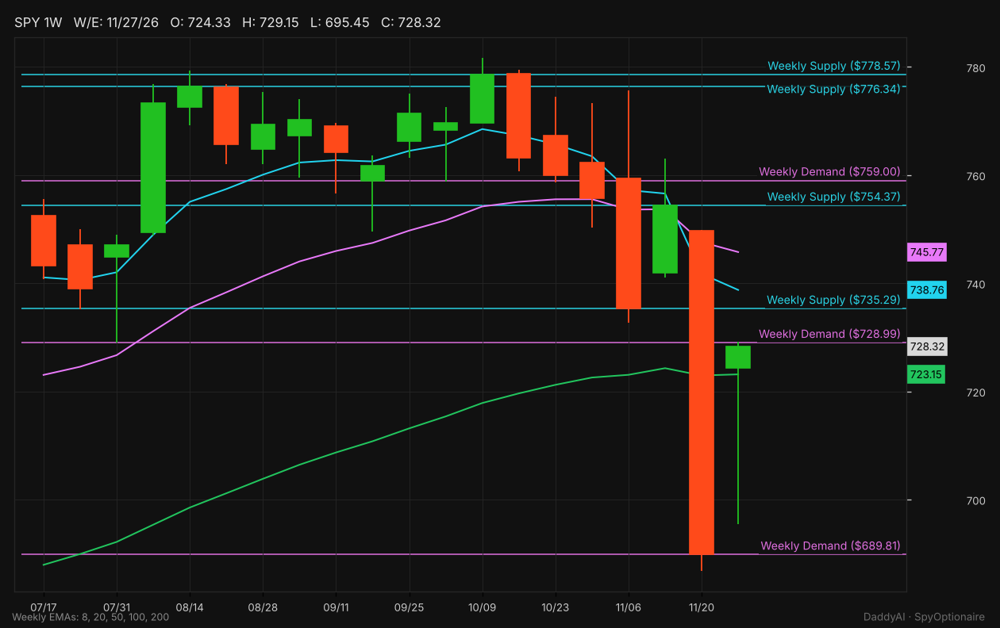
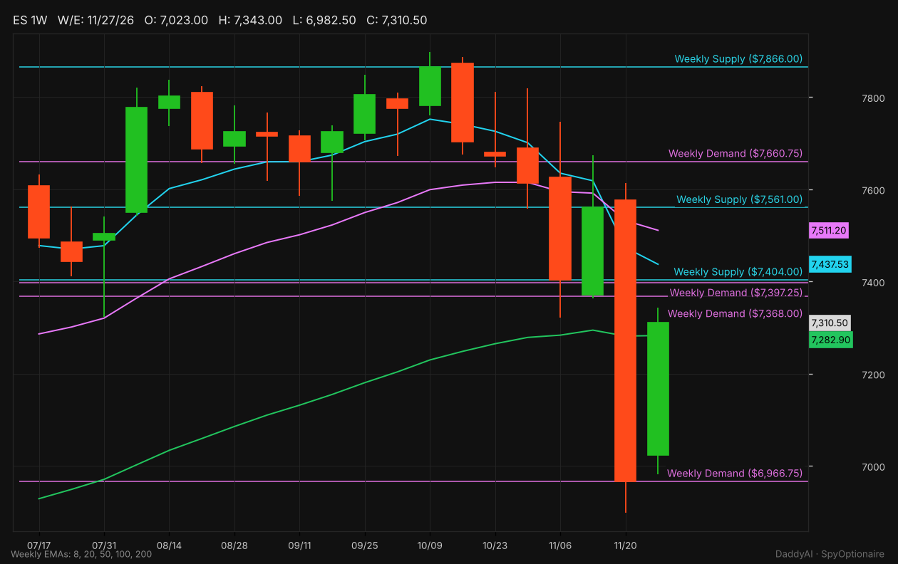
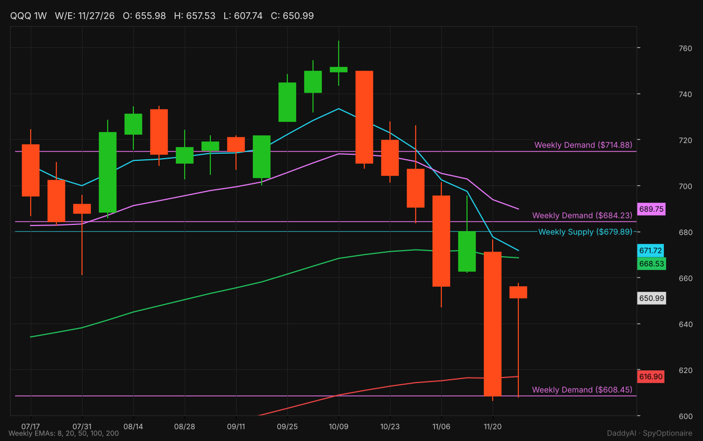
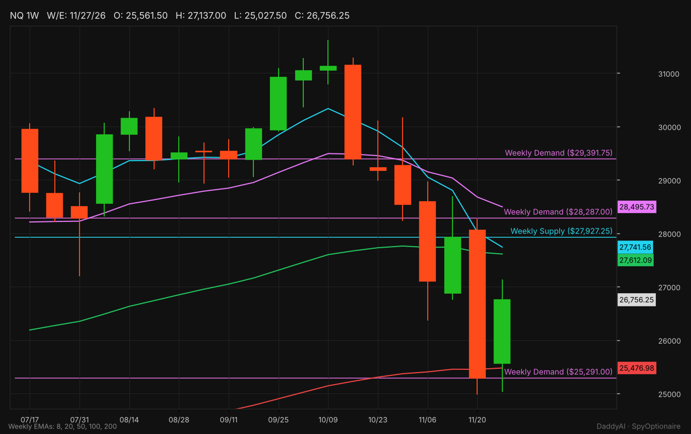
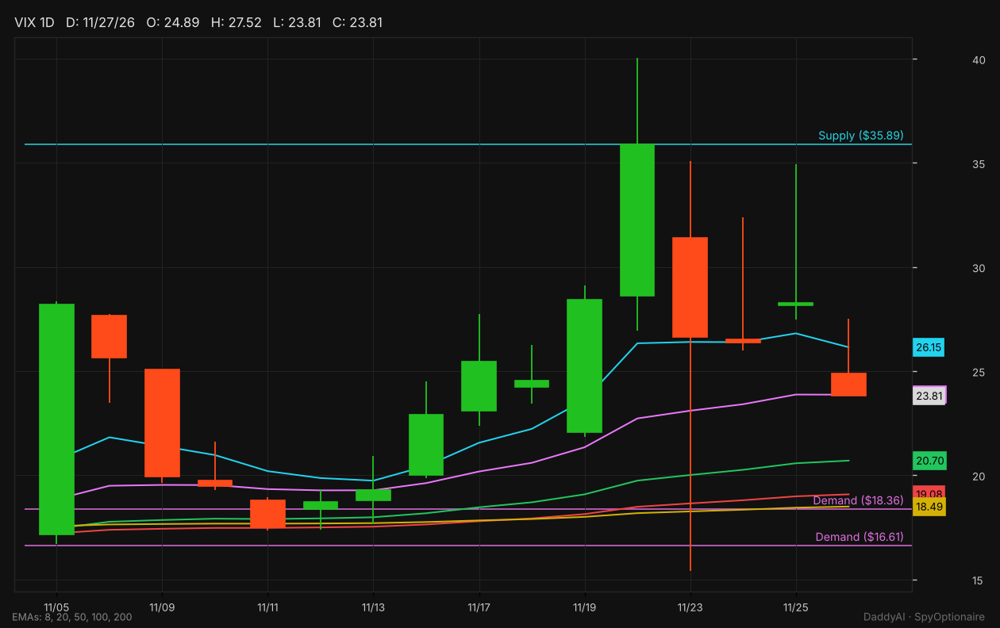
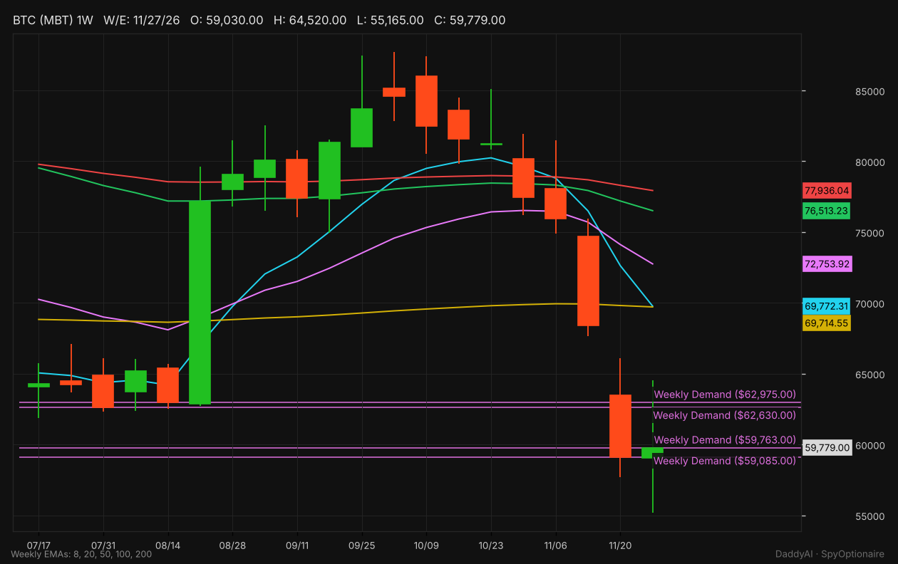
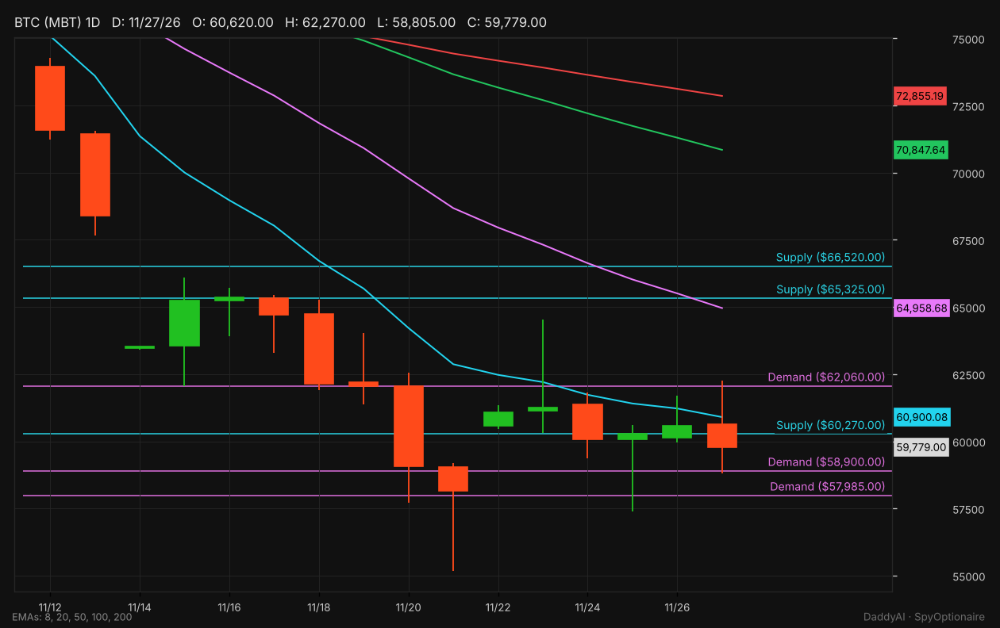

Last week the bears took SPY down more than 8%. This week the bulls took over half of it back guys, and QQQ did even better with a 7% week. But both closed right under old support that flipped to resistance. So next week comes down to one question: does that resistance break, or does it hold?

The supply/ demand indicator stayed bullish on the weekly through the whole selloff, which is why this bounce deserves respect. A busy data week will test it, with the November jobs report on Friday:

- **Mon 11/30:** no major US data.
- **Tue 12/1:** ISM manufacturing and JOLTS job openings (10:00 AM). Marvell, MongoDB and Okta report after the close.
- **Wed 12/2:** ADP jobs (8:15 AM). Salesforce and Snowflake report after the close.
- **Thu 12/3:** jobless claims (8:30 AM) and ISM services (10:00 AM). Kroger and Dollar General report before the open, Ulta and Veeva after the close.
- **Fri 12/4:** the November jobs report (8:30 AM).

The Fed meets the week after, on December 8-9. Data drops are usually received bullishly, so I'd rather let price close through a level than guess the number.

### SPY/ ES WEEKLY

SPY's weekly candle is what buyers want to see. It gapped up Monday, dipped to 695 Wednesday, then rallied into Friday's half day to close near the high at 728.32. That close put SPY back over its weekly 50ema, which it lost last week.

The daily is still catching up. SPY is back over the daily 8ema but under the 20, 50, 100 and 200ema. The 8ema is still under the 20ema, and delta still shows sellers, just fading.

The problem is where the week stopped. SPY finished just under 728.99, a June weekly demand that broke last week and is now resistance. ES sits under its own 7368 weekly level. Right above that are the 200ema, the 20ema and the 11/06 weekly supply at 735.29. That's a lot of resistance in a small space, and the 200ema rarely gives way without a retest.

Bulls need a CLOSE over 735 (ES 7404) to clear that stack. Do that and the 50/100ema near 749-750 is next... the bears' last stand. Over it, the 11/13 weekly supply at 754.37 is the target.

Bears want this week to be nothing more than a retest of broken support. Losing the daily 8ema at 723.76 would be the first crack. The real trigger is a CLOSE under the 11/20 weekly demand at 689.81 (ES 6966.75). As long as the bulls defend that demand, I struggle to be too bearish long term.

**SPY LEVELS FOR NEXT WEEK**

Supply- 728.99 (weekly) -> 729.46 -> 733.40 (200ema) -> 735.29 (weekly) -> 735.74 (20ema) -> 749.11-749.81 (50/100ema) -> 754.37 (weekly)

Demand- 723.76 (8ema) -> 689.81 (weekly) -> 682.08

**ES LEVELS FOR NEXT WEEK**

Supply- 7359 -> 7368 (weekly) -> 7384.75 (20ema) -> 7397.25 (weekly) -> 7397.64 (200ema) -> 7404 (weekly) -> 7532-7551 (50/100ema) -> 7561 (weekly)

Demand- 7267.03 (8ema) -> 6966.75 (weekly) -> 6884.50

### QQQ/ NQ WEEKLY

Tech led the bounce, but it had a rougher ride than SPY. QQQ's best day was Monday, not Friday. It popped to 657.53, then sold all the way back Wednesday to tag 608.45, the weekly demand at last week's close. Buyers defended it, and QQQ closed the week at 650.99. That's back over its weekly 100ema, but still under Monday's high, so QQQ's weekly candle is actually red.

NQ tells the same story. Monday's 27137 high is still the top of the week, and Friday stalled just under the 26888 daily supply. QQQ's daily momentum is also still in the extreme bear zone, only turning up, while SPY's has climbed out. Tech has the bigger bounce but the weaker footing.

Bulls want a CLOSE over Monday's high first (NQ 27137), which also clears that 26888 supply. The daily 20ema at 664 comes next. There's no weekly level overhead until the 11/13 weekly supply at 679.89 (NQ 27927.25), which lines up with the daily 200ema.

Bears want a second run at the lows. A CLOSE under 608.45 (NQ 25291) breaks the demand buyers just defended, and that would hand tech back to the bears.

**QQQ LEVELS FOR NEXT WEEK**

Supply- 651.42 -> 656.10 -> 664.10 (20ema) -> 679.89 (weekly) -> 680.91 (200ema) -> 684.23 (weekly) -> 688.84-696.45 (50/100ema)

Demand- 646.71 (8ema) -> 608.45 (weekly) -> 603.31

**NQ LEVELS FOR NEXT WEEK**

Supply- 26888 -> 27277.99 (20ema) -> 27927.25 (weekly) -> 28171.23 (200ema) -> 28287 (weekly)

Demand- 26564.22 (8ema) -> 26000.50 -> 25291 (weekly)

### VIX DAILY

VIX backs up the bounce. It lost a third of its value this week, from 35.89 down to 23.81, and finished right on its 20ema. That's congruent: fear came out as SPY and QQQ climbed.

The jobs report is the test for VIX too. If it holds under the 20ema through Friday, that keeps the bulls' path open, with the 50ema at 20.70 as the next demand. IF VIX gets back over its 8ema at 26.15 while SPY is still stuck under that 735 stack, that's the warning sign.

**VIX DAILY LEVELS**

Supply- 23.87 (20ema) -> 26.15 (8ema) -> 35.89

Demand- 20.70 (50ema) -> 19.08 (100ema) -> 18.36

### BITCOIN DAILY

*Bitcoin levels are based on CME Bitcoin futures (MBT).*

Bitcoin didn't join the bounce. It's IMBALANCED right now: it closed and has held under its previous daily demand at 62,060 since 11/20. Friday pushed just over that level to 62,270 and got rejected, closing at 59,779.

The weekly is what's holding it up. Bitcoin closed right on top of its June weekly demand at 59,763, and the supply/ demand indicator is still bullish on the weekly. On the daily, though, it's under every EMA, and the 8ema is under the 20ema.

The bulls first need to CLOSE back over 62,060 to get back in balance. The 60,270 supply and the 8ema near 60,900 come first. Over 62,060, the old weekly demands at 62,630-62,975 turn into resistance, then the 20ema near 64,960.

Bears want a CLOSE under 59,085, last week's weekly demand. Under that, the next demands are 58,900 and 57,985.

**BITCOIN (MBT) LEVELS**

Supply- 60270 -> 60900 (8ema) -> 62060 -> 62630 (weekly) -> 62975 (weekly) -> 64959 (20ema)

Demand- 59763 (weekly) -> 59085 (weekly) -> 58900 -> 57985

